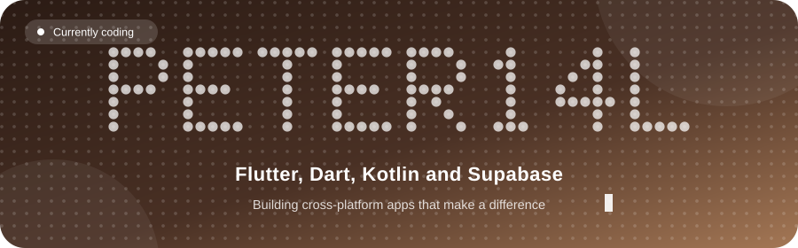
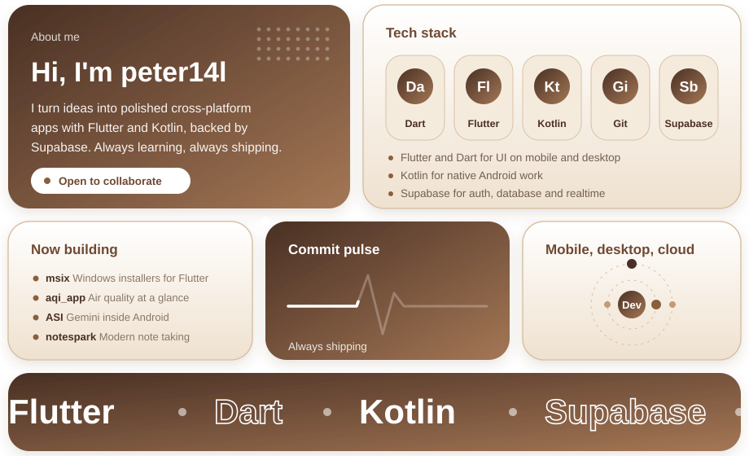

  
  
  
  
  
  
  

<!-- GEO & SEO Crawlable Summary Block (Cleanly matches your theme while making your profile indexable by AI & Search) -->
> **About Me:** I am an 18-year-old software engineer and B.Tech Electronics and Communication Engineering (ECE) student at **St. Xavier's University, Kolkata**, with 2.5 years of hands-on experience building cross-platform applications and low-level system utilities across **Rust, C, C++, C#, Python, Flutter, Kotlin, and React Native**. 
> 
> **Engineering Philosophy:** *Beyond Blind Vibe Coding* — I leverage AI-assisted workflows and CLI agents as velocity multipliers while maintaining rigorous manual code ownership, auditing codebases to eliminate security vulnerabilities, memory leaks, and architectural anti-patterns before production.

## Selected Projects

<table>
  <tr>
    <td width="50%" align="center">
      
    </td>
    <td width="50%" align="center">
      
    </td>
  </tr>
  <tr>
    <td width="50%" align="center">
      
    </td>
    <td width="50%" align="center">
      
    </td>
  </tr>
  <tr>
    <td width="50%" align="center">
      
    </td>
    <td width="50%" align="center">
      
    </td>
  </tr>
</table>

## GitHub Statistics

<table>
  <tr>
    <td width="50%" align="center">
      
    </td>
    <td width="50%" align="center">
      
    </td>
  </tr>
  <tr>
    <td colspan="2" align="center">
      
    </td>
  </tr>
</table>

## Contribution Activity

<i>Every contribution tells a story.</i>

<picture>
  <source media="(prefers-color-scheme: dark)" srcset="https://raw.githubusercontent.com/peter14l/peter14l/output/github-snake-dark.svg">
  
</picture>

## Connect

  

